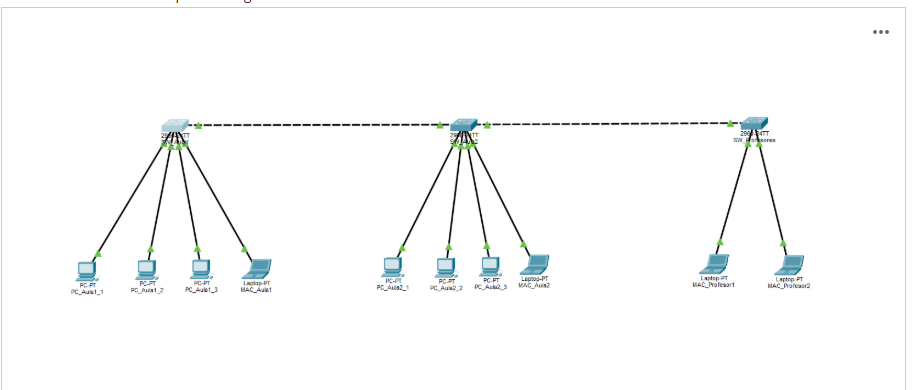
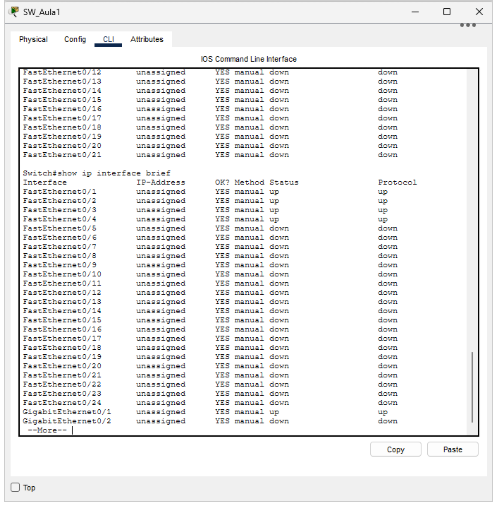
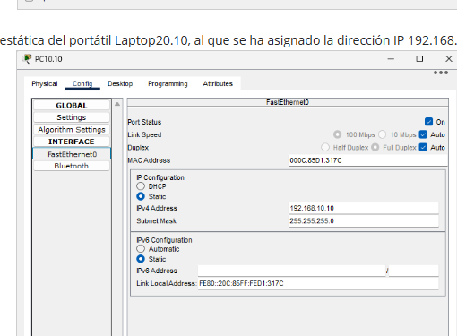
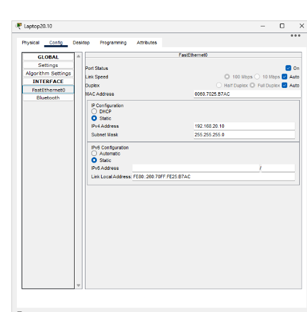
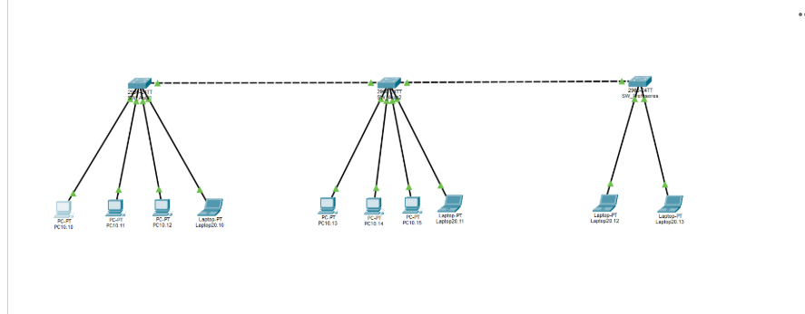
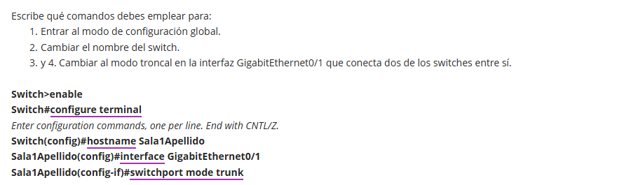

# Diseño de red de un centro educativo | Cisco Packet Tracer

**Proyecto académico de ASIR · Planificación y Administración de Redes**

## Resumen

Diseño de una topología de red simulada para un centro educativo compuesto por tres salas: dos aulas de alumnos y una sala de profesorado. El escenario incluye **3 switches**, **6 equipos de escritorio** y **4 portátiles**, con interconexiones GigabitEthernet entre switches. El proyecto original se conserva en formato `.pkt` para poder abrirlo en Cisco Packet Tracer.

> **Alcance de las evidencias:** las capturas documentan la topología, el direccionamiento estático mostrado para un PC y un portátil y una consulta de interfaces del switch. La PAC también plantea configurar VLAN 10 y 20 y un puerto troncal; para confirmar que todas estas configuraciones están aplicadas en el archivo `.pkt` habría que comprobarlo en Packet Tracer con comandos de verificación.

## Tecnologías y conceptos

- Cisco Packet Tracer y configuración mediante CLI Cisco IOS.
- Diseño de topologías LAN y conexiones Ethernet/GigabitEthernet.
- Direccionamiento IPv4 estático y máscaras de subred.
- Segmentación lógica planteada con **VLAN 10** (equipos de alumnos) y **VLAN 20** (portátiles/profesorado según la actividad).
- Puertos de acceso y enlaces troncales (conceptos y comandos abordados en la PAC).

## Escenario de red

| Elemento | Cantidad | Función |
|---|---:|---|
| Switches | 3 | Uno por sala, unidos mediante enlaces GigabitEthernet |
| PCs | 6 | Tres equipos de escritorio en cada una de las dos aulas de alumnos |
| Portátiles | 4 | Uno en cada aula de alumnos y dos en la sala de profesorado |



## Evidencias documentadas

### 1. Topología y estado de interfaces

En las capturas se observa el diseño de los tres grupos de equipos, sus conexiones a los switches y la ejecución del comando `show ip interface brief` en uno de ellos.



### 2. Direccionamiento estático de los equipos

La actividad establece dos rangos IPv4: **192.168.10.0/24** para los PCs y **192.168.20.0/24** para los portátiles. Las capturas muestran, como ejemplo:

- PC: `192.168.10.10 / 255.255.255.0`
- Portátil: `192.168.20.10 / 255.255.255.0`





### 3. Nombres de los dispositivos

La PAC documenta la identificación de PCs y portátiles y la disposición de los switches en el mapa lógico.



### 4. Comandos Cisco IOS recogidos en la actividad

```text
Switch> enable
Switch# configure terminal
Switch(config)# hostname Sala1Apellido
Sala1Apellido(config)# interface GigabitEthernet0/1
Sala1Apellido(config-if)# switchport mode trunk
```

Esta secuencia aparece en la respuesta académica de la PAC. **La captura, por sí sola, no demuestra que el puerto estuviera en modo trunk en el archivo `.pkt`.**



## Archivo de Packet Tracer

[Descargar el diseño `.pkt`](packet-tracer/ASIR_Eduardo_Medialdea.pkt)

Abrirlo con una versión compatible de Cisco Packet Tracer. Antes de afirmar que las VLAN, troncales y pruebas de comunicación están completadas, verificar en cada switch `show vlan brief`, `show interfaces trunk` y realizar pruebas de ping según corresponda.

## Limitaciones y próximos pasos

- Las capturas aportadas **no muestran** la salida de `show vlan brief`, `show interfaces trunk` ni pruebas de ping entre equipos; Pero fueron verificadas en el `.pkt`.
- El archivo `.pkt` se incluye tal como fue entregado.

## Autor

Eduardo Medialdea Dominguez · Estudiante de ASIR en ILERNA.

*Repositorio creado a partir de un laboratorio académico. Las capturas se han recortado para mostrar únicamente evidencias relevantes, sin publicar el enunciado completo de la actividad.*
